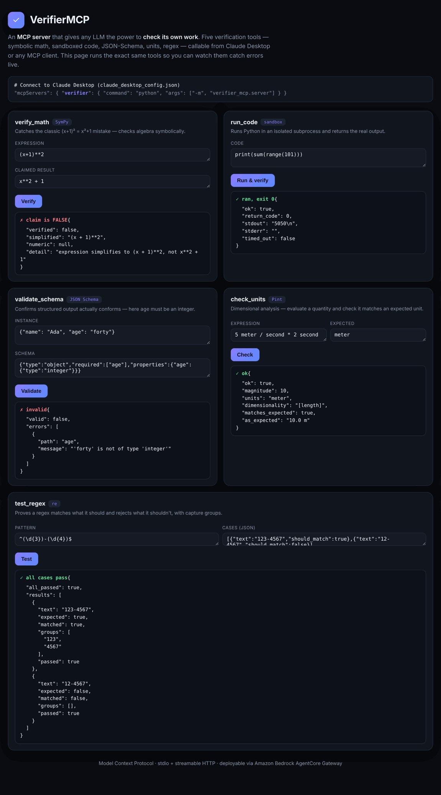

# VerifierMCP

> An **MCP server** that gives any LLM the power to **check its own work**.
> Instead of trusting a model's arithmetic, regex, JSON or "the code prints X", the model
> can *call a tool and verify it*. Five verification tools over the
> [Model Context Protocol](https://modelcontextprotocol.io): symbolic math, sandboxed code
> execution, JSON-Schema validation, dimensional analysis, and regex testing.

<p align="center">
  
</p>

Built with the official **MCP Python SDK** (FastMCP). Works in **Claude Desktop** and any
MCP client over **stdio**, or remotely over **streamable HTTP** (e.g. behind **Amazon Bedrock
AgentCore Gateway**).

---

## Why it matters

LLMs are confidently wrong about exactly the things that are *mechanically checkable*:
`(x+1)² = x²+1`, a regex that doesn't quite match, JSON that violates its schema, a unit
slip, "this function returns 5050". VerifierMCP turns each of those into a tool call, so an
agent can **replace an assertion with a verified fact**.

## The tools

| Tool | Checks | Engine |
|------|--------|--------|
| `verify_math` | Is an equation an identity? Does a claimed result hold? | SymPy |
| `run_code` | What does this Python snippet *actually* output? | sandboxed subprocess |
| `validate_schema` | Does this JSON conform to its JSON Schema? | jsonschema (Draft 2020-12) |
| `check_units` | Is this quantity/equation dimensionally correct? | Pint |
| `test_regex` | Does this regex match/reject the right cases? | `re` |

Each tool body lives in [`src/verifier_mcp/tools/`](src/verifier_mcp/tools/) as a pure
function, so it is unit-tested without the protocol and reused by the web playground.

---

## Quickstart

```bash
pip install -r requirements.txt

# Run the MCP server over stdio (what Claude Desktop launches)
PYTHONPATH=src python -m verifier_mcp.server

# Or serve it over HTTP (MCP streamable transport on :8000/mcp)
PYTHONPATH=src python -m verifier_mcp.server --http

# See it in action — the visual playground
PYTHONPATH=src uvicorn verifier_mcp.playground:app --port 8080   # http://localhost:8080
```

### Connect to Claude Desktop

Add to `claude_desktop_config.json`:

```json
{
  "mcpServers": {
    "verifier": {
      "command": "python",
      "args": ["-m", "verifier_mcp.server"],
      "env": { "PYTHONPATH": "/absolute/path/to/verifier-mcp/src" }
    }
  }
}
```

Restart Claude Desktop and ask it something like *"Is (x+1)² equal to x²+1? Use the verifier."*
— it will call `verify_math` and come back with the checked answer.

---

## Self-checking agent demo (Groq + MCP)

[`examples/self_checking_agent.py`](examples/self_checking_agent.py) connects a **Groq** LLM to
this server over **real MCP** (via `langchain-mcp-adapters`), instructs it to *verify before
asserting*, and watches it catch its own mistake:

```bash
pip install -r requirements-demo.txt
export GROQ_API_KEY=gsk_...                       # real Groq agent
python examples/self_checking_agent.py

python examples/self_checking_agent.py --offline  # no key: scripted LLM, REAL MCP verification
```

```text
[offline] Question: Is (x+1)^2 equal to x^2 + 1? If not, what is the correct expansion?

  [Assistant] draft answer: "(x+1)^2 = x**2 + 1"
  → verify_math((x+1)**2, claimed_result=x**2 + 1)  [real MCP call]
    MCP result: verified=False  —  expression simplifies to (x + 1)**2, not x**2 + 1
  → verify_math((x+1)**2, claimed_result=x**2 + 2*x + 1)  [real MCP call]
    MCP result: verified=True

  [Assistant] Corrected: (x+1)^2 = x^2 + 2x + 1 — verified, not x^2 + 1.
```

---

## Deploy remotely (Amazon Bedrock AgentCore Gateway)

The HTTP transport (`--http`, container in [`Dockerfile`](Dockerfile)) exposes a standard MCP
endpoint at `/mcp`. Point **AgentCore Gateway** at it to turn these verifiers into tools any
Bedrock agent can call:

```bash
docker build -t verifier-mcp .
docker run -p 8000:8000 verifier-mcp          # MCP over HTTP at http://localhost:8000/mcp
```

---

## The sandbox

`run_code` executes snippets in a fresh `python -I -S` subprocess with **no inherited
environment**, a **temp working dir**, and POSIX **resource limits** (CPU, memory, no forking,
no file writes) plus a wall-clock timeout. That is appropriate for a local dev tool. For
untrusted, multi-tenant use, run the whole server inside a container / gVisor / Firecracker —
the subprocess limits are defense-in-depth, not a complete jail.

---

## Tests

```bash
PYTHONPATH=src pytest -q      # 18 passed — tool logic + MCP protocol registration/dispatch
```

## Tech stack

**Model Context Protocol** (FastMCP) · **SymPy** · **jsonschema** · **Pint** · **FastAPI** ·
**Docker** · **GitHub Actions** · Amazon Bedrock AgentCore Gateway–ready

## License

MIT © Arash Omranpour
